<p align="center">
  
</p>

<p align="center">
  <a href="LICENSE"></a>
  
  
  <a href="https://github.com/2yuri/cmdtab/actions/workflows/ci.yml"></a>
</p>

**cmdtab** replaces the macOS ⌘⇥ switcher with one that switches between **windows**, shows only the
ones **on the desktop you are looking at**, and does **nothing at all** while you aren't using it.
Two optional parts come with it: [**Tiling**](#tiling), a scrolling strip of full-height columns, and
the [**Island**](#island), which puts your agents, music, files and day in the notch.

- **Windows, not apps.** Two VS Code windows are two choices, or one grouped tile if you prefer.
- **This desktop only.** Each Space stays its own context. "All Desktops" is one click away.
- **Idle means idle.** No timers, no polling, no screenshots in the background. cmdtab wakes up when you
  press ⌘⇥ and builds the list on the spot.
- **One permission.** Accessibility, to read window titles and focus the window you pick. Screen
  Recording is only requested if you turn on window previews.

## Switcher

<table>
  <tr>
    <td width="50%"></td>
    <td width="50%"></td>
  </tr>
  <tr>
    <td></td>
    <td></td>
  </tr>
  <tr>
    <td></td>
    <td></td>
  </tr>
  <tr>
    <td></td>
    <td></td>
  </tr>
</table>

### Three styles

<p align="center"></p>

Icons like the macOS switcher, a snapshot of each window, or a compact list of titles. Previews are
captured only while the switcher is open, kept in memory, and never saved or sent anywhere.

Search with **⌘F** while the switcher is open, or turn on **Open in search mode** so the search bar is
always there: hold ⌘ and tap ⇥ as usual, or let go of ⌘ and type.

## Tiling 

<table>
  <tr>
    <td width="50%"></td>
    <td width="50%"></td>
  </tr>
  <tr>
    <td></td>
    <td></td>
  </tr>
  <tr>
    <td colspan="2">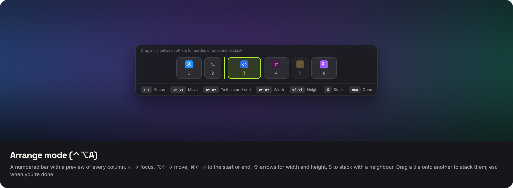</td>
  </tr>
  <tr>
    <td colspan="2">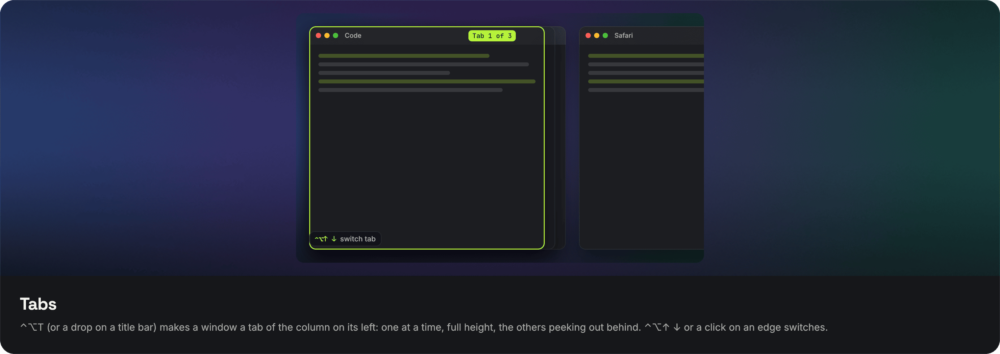</td>
  </tr>
</table>

Off by default; turn it on in **Settings → Tiling**.

- **Scroll Lock.** The windows on the current desktop become full-height columns on a strip wider than
  the screen. Focus moves with ⌃⌥← → (or the switcher, or a click) and the strip slides there, so the
  columns in between pass by like a scroll. Neighbouring columns peek in at the sides. Hold ⌃⌥ and
  scroll sideways to slide the strip by hand; it settles on the column you stop at. Optional: wrap
  around from the last column to the first, animation speed, or no animation.
- **Stacks.** Drop a window on the middle of another column and they share its height; drop it on a
  column's side to move it there instead, or at the screen's edge to join the next column. Drag it
  out, or press ⌃⌥S, to unstack. By default dragging stacks only in Arrange mode (Always / In Arrange
  mode / Off in Settings).
- **Tabs.** ⌃⌥T makes the focused window a tab of the column on its left (or drop it on a column's
  title bar): one window at a time, full height, the others peeking out a little behind it. ⌃⌥↑ ↓
  or a click on an edge brings one forward, ⌘⇥ goes straight to it, and ⌃⌥T again takes it out.
  The strip map shows how many tabs a column holds.
- **Arrange mode.** ⌃⌥A shows a numbered bar with a preview of every column, and the keys below
  rearrange the strip until you press esc. Drag a tile between others to reorder, or onto one to stack.
- **Sizes that stick.** Columns are 33, 50, 66 or 100% wide; stacked windows 33, 50 or 100% tall.
  Cycle with ⌃⌥R and ⌃⌥⇧R or drag an edge; each app's next windows open the same way. Every remembered
  size is listed, searchable, in Tiling › Remembered Sizes.
- **Floating apps.** Finder, System Settings and the other apps that come with macOS, plus any app you
  add, stay out of the strip. Going back to the strip hides them (like ⌘H) until you ⌘⇥ to them.
- **Screen padding.** Keeps every window, tiled or not, a set distance from the screen edges, measured
  from the edges so the menu bar counts towards it.
- **Dim other windows.** A dark layer right below the focused window.
- **Drop on the notch.** With the Island's Windows module on, drag a window up into the notch: the
  island shows your columns. Let go between two to move the window there, on one to stack it.

Turning Scroll Lock off puts every window back where it was.

## Island 

<table>
  <tr>
    <td colspan="2">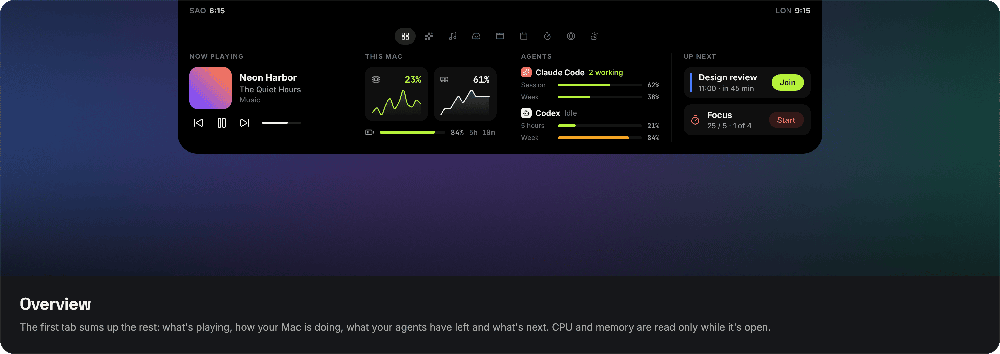</td>
  </tr>
  <tr>
    <td width="50%">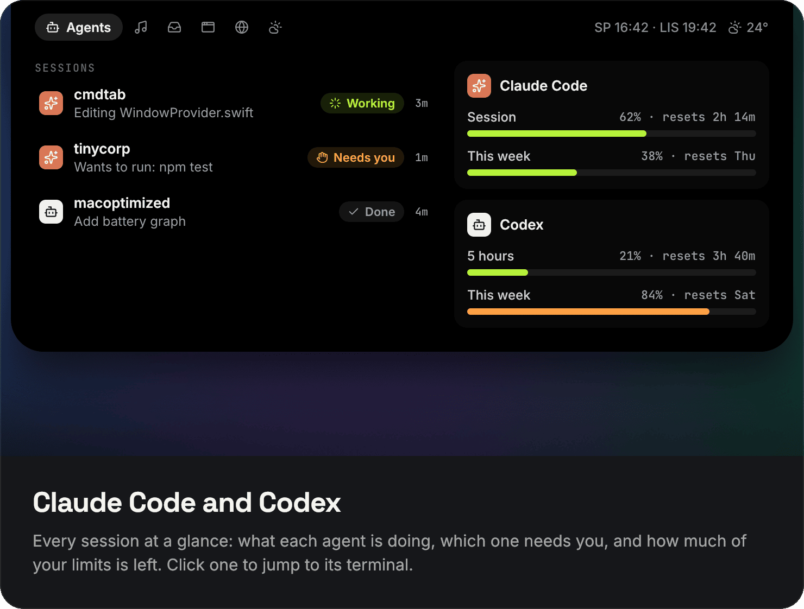</td>
    <td width="50%">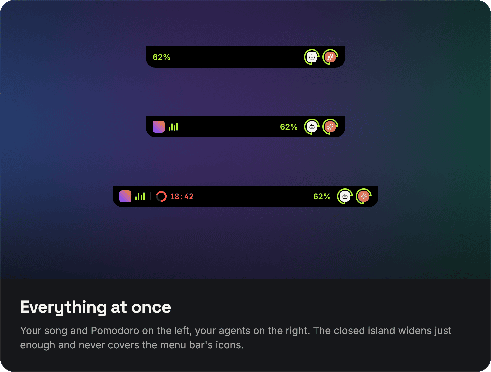</td>
  </tr>
  <tr>
    <td>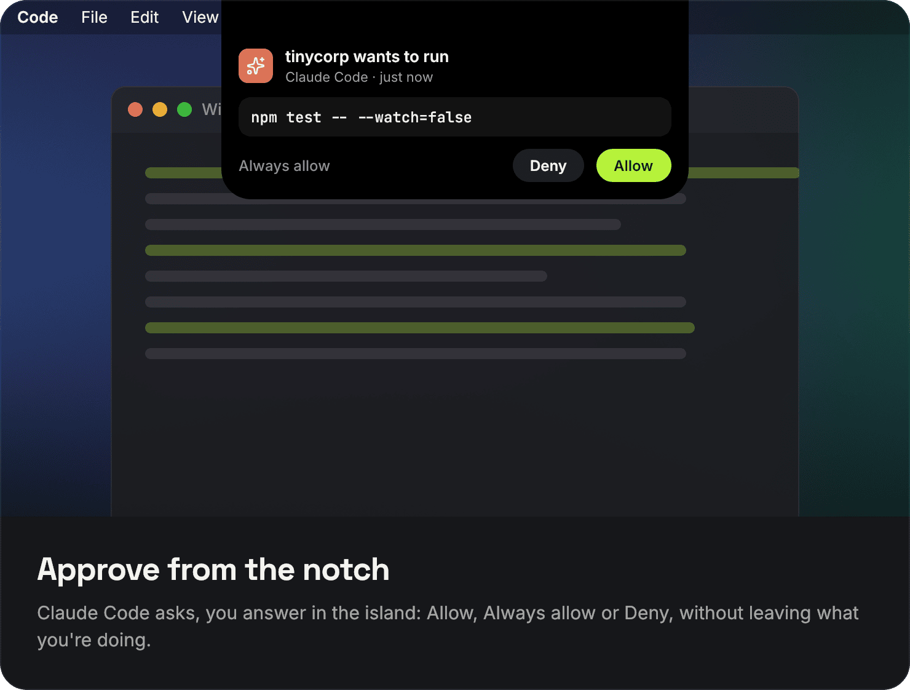</td>
    <td>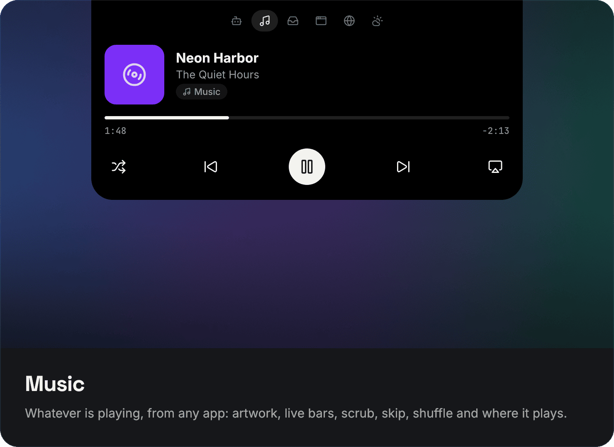</td>
  </tr>
  <tr>
    <td>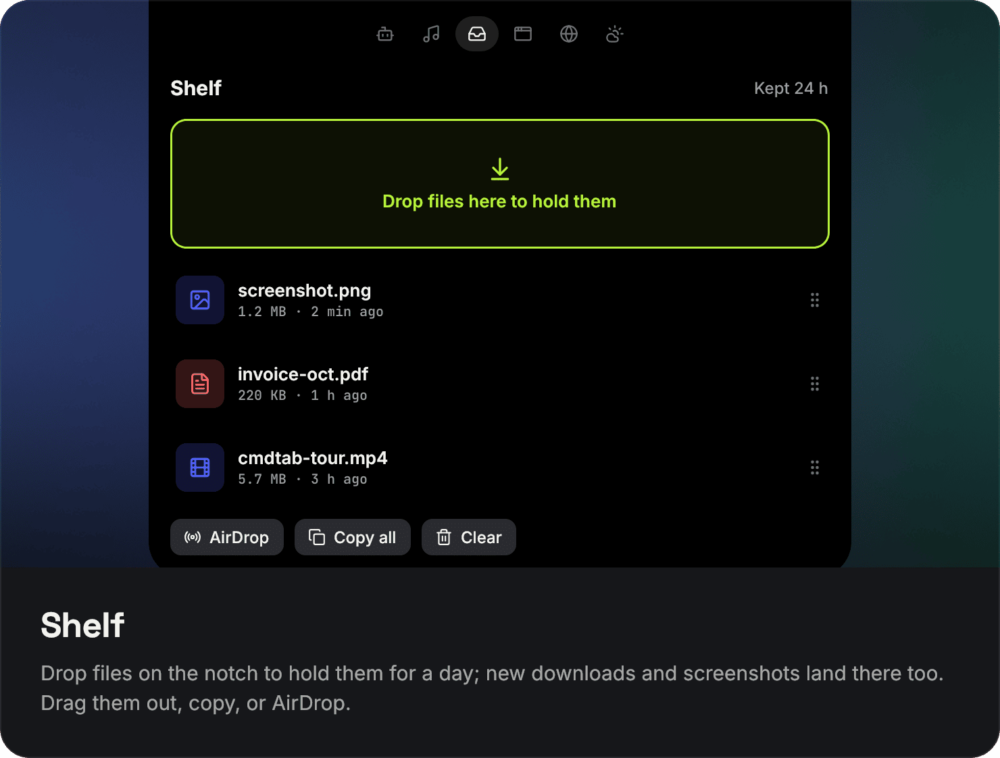</td>
    <td>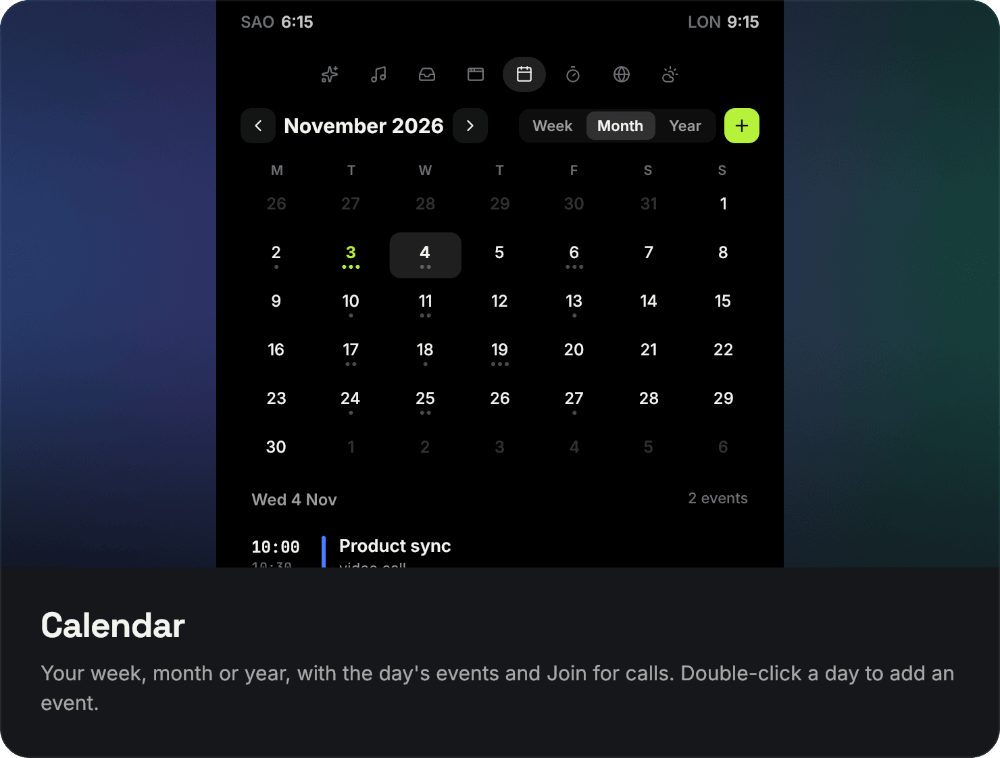</td>
  </tr>
  <tr>
    <td>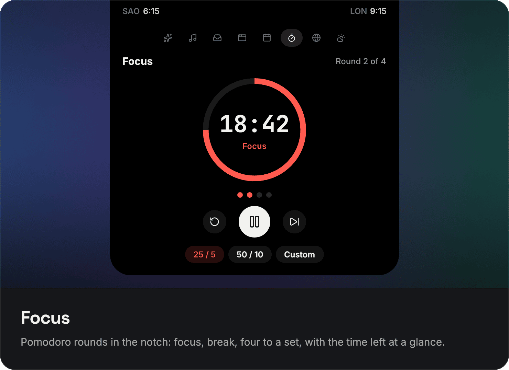</td>
    <td>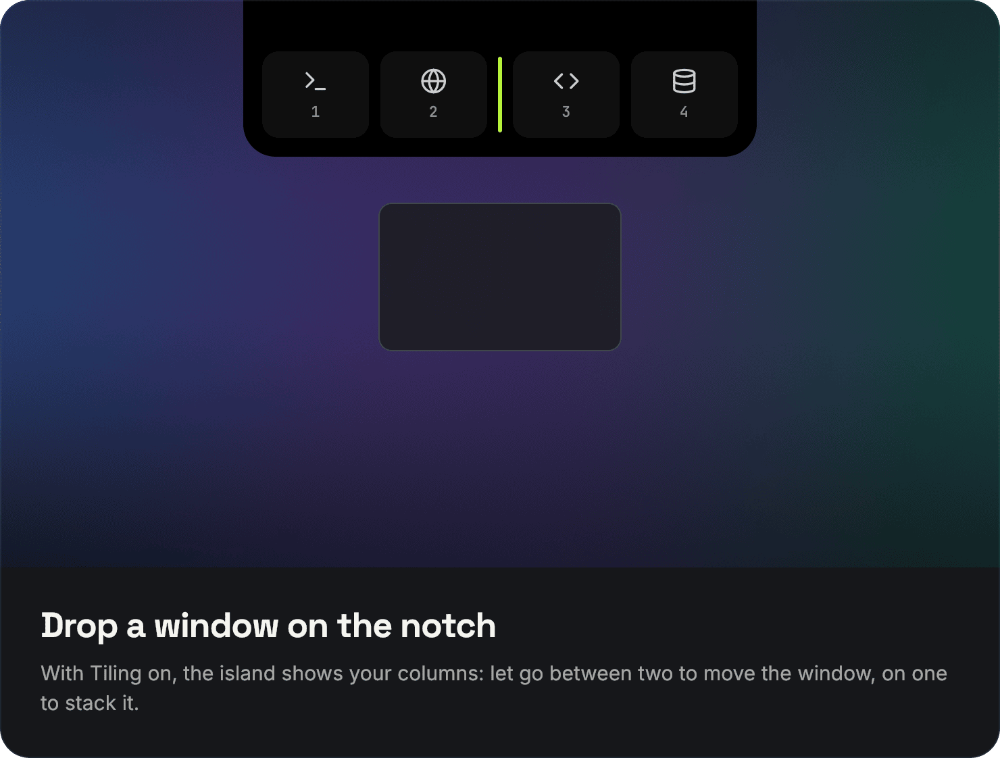</td>
  </tr>
  <tr>
    <td>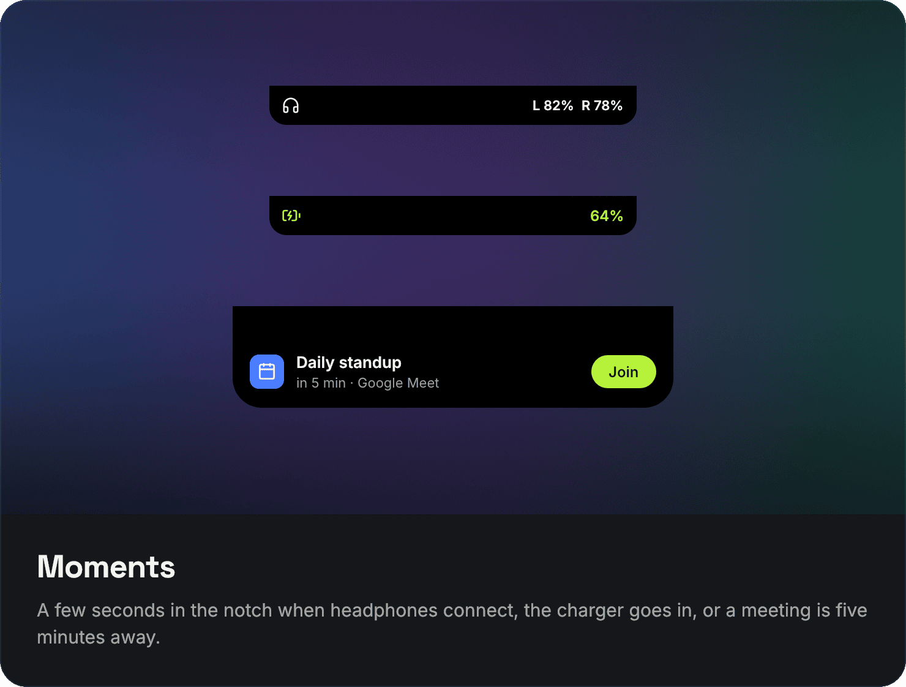</td>
    <td>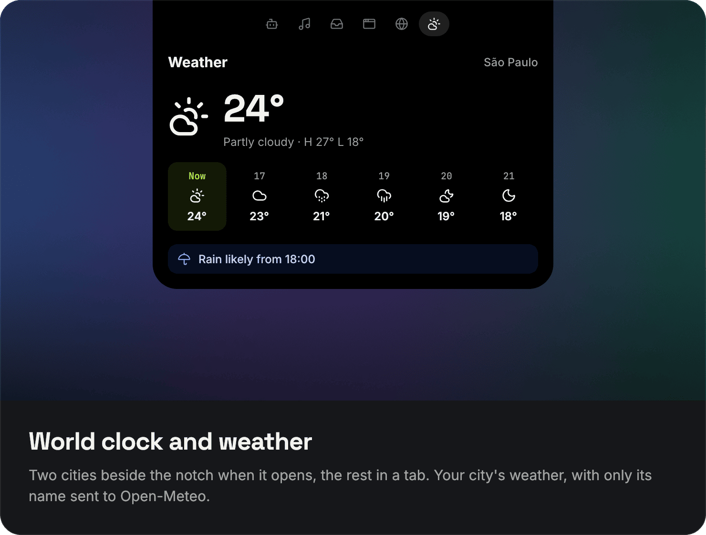</td>
  </tr>
</table>

Off by default; turn it on in **Settings → Island**, then switch on the modules you want. A module
that is off reads nothing and runs nothing. The island stays the notch's size until something
happens, opens when the pointer rests on it (or on a click), and on a Mac without a notch it is a
small pill under the menu bar.

- **Overview.** The first tab sums up the rest: what's playing, CPU and memory with a live line and
  the battery (read only while it's open), what your agents have left, and what's next: the next event
  with Join and a Pomodoro one click away.
- **Agents.** Claude Code and Codex sessions: which ones are working, which one needs you, and what
  is left of your session and weekly limits. Click a session to bring its terminal forward; search
  when there are many. Read from the files each tool keeps on your Mac, only when they change.
- **Approvals.** Optional: Claude Code asks for permission in the island and you answer Allow,
  Always allow or Deny without leaving what you're doing.
- **Everything at once.** Closed, the island keeps yours on the left (the song, the Pomodoro, or the
  agent waiting for you) and the agents on the right, one mark per tool, and widens only as much as
  it needs.
- **Music.** Whatever is playing, from any app: artwork, live bars, scrub, skip, shuffle and AirPlay.
  With nothing playing it keeps its shape, quietly.
- **Shelf.** Drop files on the notch and they wait there for 24 hours. New downloads and screenshots
  can land there too. Drag them out, copy them or AirDrop them.
- **Windows.** The windows on this desktop, with search. Drag a window up to the notch to put it on
  the left or right half, fill the screen or centre it; with Tiling on, to move or stack it.
- **Calendar.** Your week, month or year from the Calendar app, the picked day's events (all-day ones
  too) with Join for calls, and new events: double-click a day or press +, then set when it starts,
  ends or how long it lasts. Scroll over a day or an hour to change it.
- **Meetings.** Your next event five minutes before it starts, with Join.
- **Focus.** A Pomodoro timer: 25/5, 50/10 or your own, four rounds to a set, ticking beside the notch.
- **World clock and Weather.** Two cities beside the notch, the rest in a tab; your city's weather,
  with only the city name sent to Open-Meteo.
- **Effects.** Rain, snow or fireflies in the island's wings, on the screen or both, picked in its
  own tab with a live preview: amount, size, speed, opacity, direction and the fireflies' colour.
  Weather makes it follow the sky in your city. Pauses on battery and in Low Power Mode.
- **Moments.** A few seconds when headphones connect (with their battery), the charger goes in, or
  the battery runs low.

Calendar and Meetings ask for Calendar access, Moments for Bluetooth, and watching for new downloads
for the Downloads and Desktop folders, each only when you turn that module on.

## Keys

### Switcher

| Keys | Action |
|---|---|
| ⌘⇥ / ⌘⇧⇥ | Open the switcher, next / previous window |
| ⌘` | Back one, while the switcher is open |
| ← → ↑ ↓ | Move the selection (↑↓ move by row) |
| Release ⌘ or ↩ | Switch to the selected window |
| esc | Close without switching |
| ⌘F | Search |
| ⌘W / ⌘M / ⌘Q | Close the window / minimize it / quit its app, without switching |

A quick ⌘⇥ tap switches to the previous window without showing the panel.

### Tiling

With Scroll Lock on:

| Keys | Action |
|---|---|
| ⌃⌥← / ⌃⌥→ | Focus the column on the left / right |
| ⌃⌥ + scroll | Slide the strip |
| ⌃⌥⇧← / ⌃⌥⇧→ | Move the focused column |
| ⌃⌥R / ⌃⌥⇧R | Cycle the column's width / the window's height in a stack |
| ⌃⌥S | Stack the window under the column on its left, or take it out |
| ⌃⌥T | Make the window a tab of the column on its left, or take it out |
| ⌃⌥↑ / ⌃⌥↓ | Focus within a stack, or switch tabs |
| ⌃⌥A | Arrange mode |

### Arrange mode

| Keys | Action |
|---|---|
| ← → / ↑ ↓ | Focus a column / a window in a stack |
| ⌥← / ⌥→ | Move the column |
| ⌘← / ⌘→ | Move it to the start / end |
| ⇧← / ⇧→ | Narrower / wider |
| ⇧↑ / ⇧↓ | Taller / shorter in a stack |
| S, then ← or → | Stack with the column on that side (D unstacks, S or esc goes back) |
| T, then ← or → | Tab with the column on that side (D takes it out, T or esc goes back) |
| esc | Done |

## Settings

<p align="center"></p>

Open them from the ⌘ icon in the menu bar, or by opening cmdtab again.

- **Switcher:** current desktop or all desktops, grouping by app, minimized and hidden windows,
  style, size, theme, preview of the selected window, quick switch, search mode.
- **Shortcuts:** what every key does, and a switch to hand ⌘⇥ back to macOS.
- **Tiling (beta):** Scroll Lock, column widths and stack heights, remembered sizes, floating
  apps, animation, screen padding, dimming.
- **Island:** which screens get it, hover or click, the modules and their order, Shelf and
  weather, and the Claude Code and Codex connections.
- **Exceptions:** hide apps from the switcher, or leave ⌘⇥ to an app while it is in front
  (virtual machines, remote desktops).
- **Privacy:** what cmdtab can access, live.
- **About:** version, and automatic updates (on by default, one check a day).

cmdtab follows the system light/dark appearance and Reduce Transparency, and labels its tiles for
VoiceOver.

## Install

1. Download **CmdTab-vX.Y.Z.dmg** from the [latest release](https://github.com/2yuri/cmdtab/releases/latest).
2. Open it and drag **CmdTab** to **Applications**. The app and the disk image are signed with a
   Developer ID and notarized by Apple, so they open without warnings. A `.zip` of the app is there too.
3. On first launch, allow **Accessibility** (System Settings → Privacy & Security → Accessibility).
   cmdtab takes over ⌘⇥ as soon as that is granted.

Requires macOS 14 or later. Later versions install themselves: cmdtab checks once a day and asks
before it installs. Turn that off in Settings → About.

<details>
<summary>Build from source</summary>

```sh
brew install xcodegen
git clone https://github.com/2yuri/cmdtab.git && cd cmdtab
make install            # builds a Release app and copies it to /Applications
```

Signing uses the team in `project.yml`. To build with your own Apple ID, pass your team ID:
`make install DEVELOPMENT_TEAM=YOURTEAMID`.

</details>

## How it works

| | |
|---|---|
| Hot keys | ⌘⇥ is a Carbon global hot key, so the WindowServer wakes cmdtab only for that key. In-switcher keys are registered only while the panel is open, and keep working under Secure Input. |
| Window list | One WindowServer query for the on-screen order (most recently used first), filtered by Space, plus one Accessibility call per app for titles. Built on demand, never kept in sync. |
| Focusing | Brings the exact window forward, unminimizing or unhiding it when needed. |
| Previews | ScreenCaptureKit snapshots, only while the panel is open, selected window first. |
| Tiling | Event-driven: Accessibility notifications (window opened, closed, focused, moved) and ⌃⌥ hot keys. Windows are moved through Accessibility; slides are paced by the display, each app on its own queue. Columns out of view are parked just past the right edge of the screen. The scroll tap is switched on only while ⌃⌥ is held. |
| Island | One panel over the notch that never changes size; only the shape inside animates, and the spinning rings and music bars are Core Animation, so they cost no CPU. Agents are read on file-system events in `~/.claude` and `~/.codex`. Approvals come from a Claude Code hook through a local socket in `~/Library/Application Support/CmdTab`. Now Playing comes from the system's media service through a small bridge, since macOS answers only Apple's own processes. Calendar uses EventKit; Weather is one Open-Meteo request every 30 minutes. Effects are Core Animation particle emitters, so the GPU moves every drop and nothing runs per frame; on the screen they sit in a panel that never takes a click. |
| Updates | [Sparkle](https://sparkle-project.org) fetches `appcast.xml` from the latest GitHub release once a day. An update installs only if its EdDSA signature matches the key in the app and it carries the same Developer ID. No system profile or other data is sent. |

Telling which Space a window is on and focusing one specific window has no public API, so cmdtab uses a
few private SkyLight calls (`Sources/CmdTab/System/PrivateAPI.swift`). They are resolved at runtime: a
macOS update that removes one disables that feature instead of crashing the app.

> [!NOTE]
> Turning the native ⌘⇥ off is global WindowServer state that outlives the process. cmdtab turns it back
> on when it quits, is paused, or receives a termination signal. If it is force-killed (`kill -9`) or
> crashes, open cmdtab again and quit it from the menu, or log out.

### Troubleshooting

Diagnostics go to the unified log at debug level (free unless someone is reading them):

```sh
log stream --level debug --predicate 'subsystem == "dev.yuri.CmdTab"'
```

If Accessibility shows cmdtab as enabled but it still asks, remove it from the list with − and add it
again: the permission is tied to the app's signature.

## Contributing

Bug reports, ideas and pull requests are welcome. See [CONTRIBUTING.md](CONTRIBUTING.md). cmdtab aims to
stay small: features that need always-on background work are out of scope.

## License

[GPL-3.0](LICENSE) © 2026 Yuri Miguel
