<p align="center">
  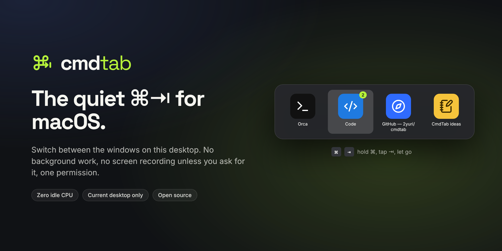
</p>

<p align="center">
  <a href="LICENSE"></a>
  
  
  <a href="https://github.com/2yuri/cmdtab/actions/workflows/ci.yml"></a>
</p>

**cmdtab** replaces the macOS ⌘⇥ switcher with one that switches between **windows**, shows only the
ones **on the desktop you are looking at**, and does **nothing at all** while you aren't using it.

- **Windows, not apps.** Two VS Code windows are two choices, or one grouped tile if you prefer.
- **This desktop only.** Each Space stays its own context. "All Desktops" is one click away.
- **Idle means idle.** No timers, no polling, no screenshots in the background. cmdtab wakes up when you
  press ⌘⇥ and builds the list on the spot.
- **One permission.** Accessibility, to read window titles and focus the window you pick. Screen
  Recording is only requested if you turn on window previews.

## Features

<table>
  <tr>
    <td width="50%">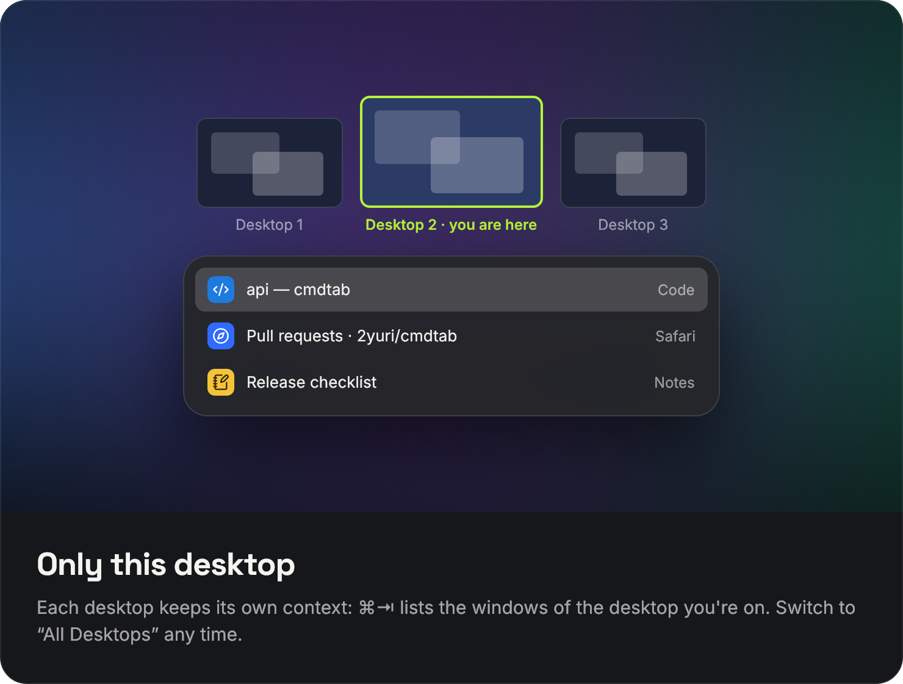</td>
    <td width="50%">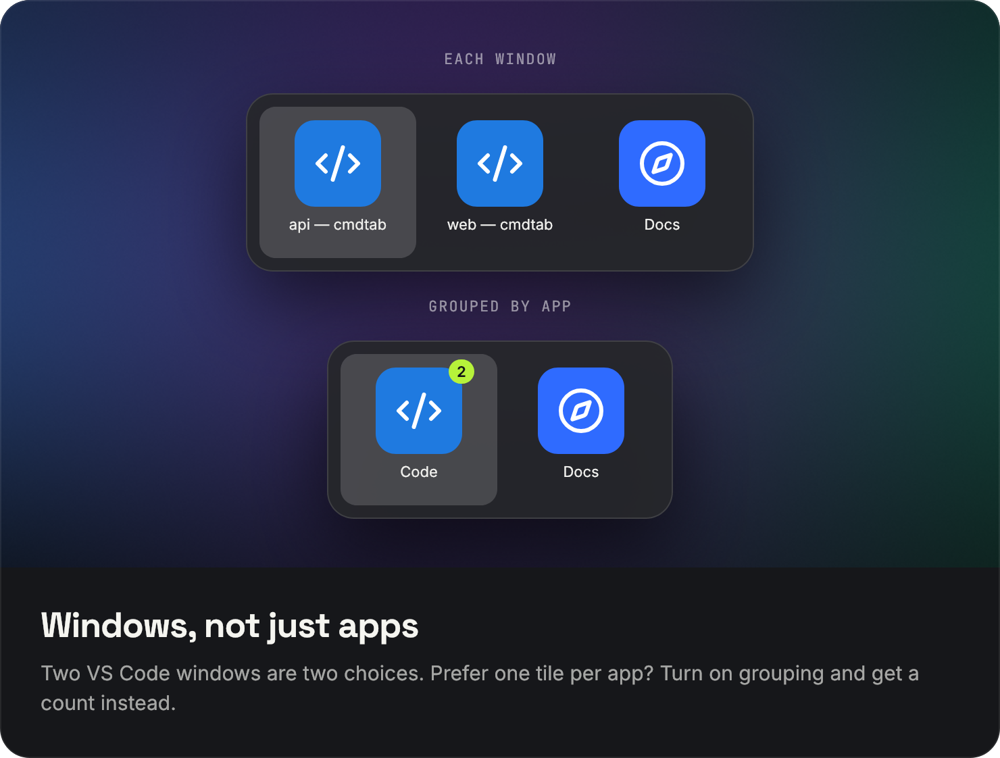</td>
  </tr>
  <tr>
    <td>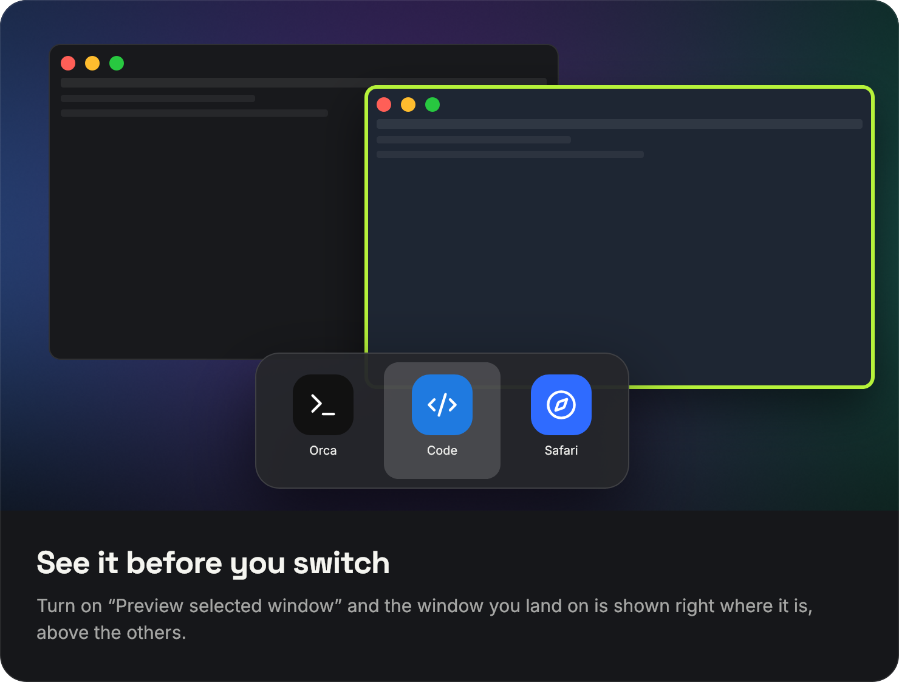</td>
    <td>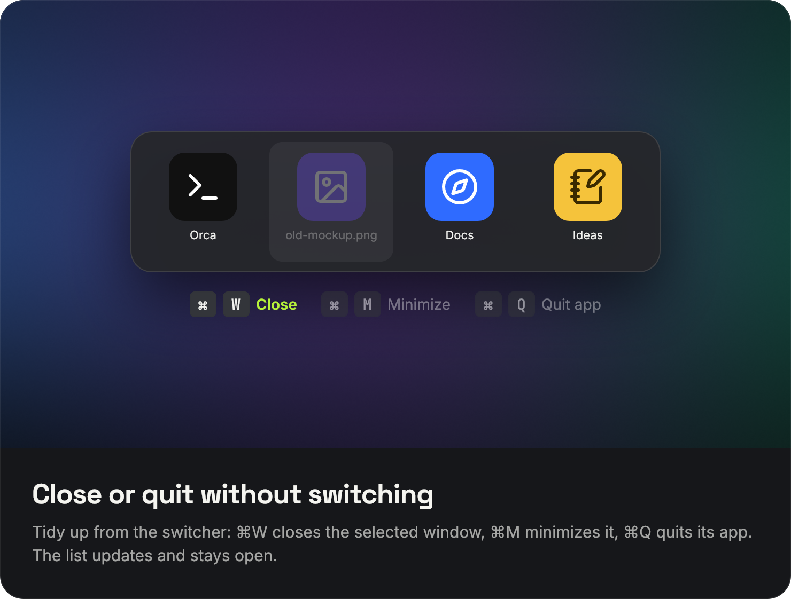</td>
  </tr>
  <tr>
    <td>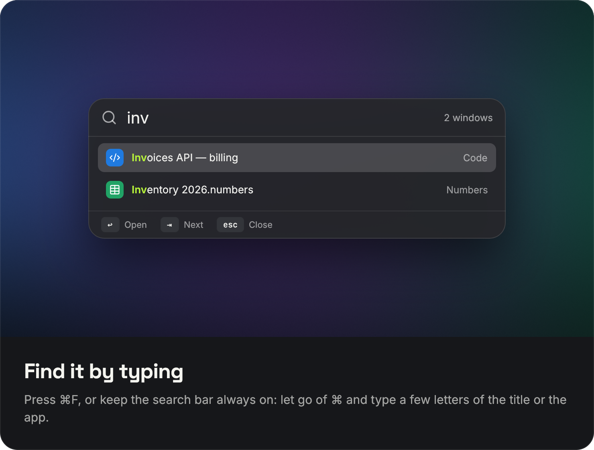</td>
    <td>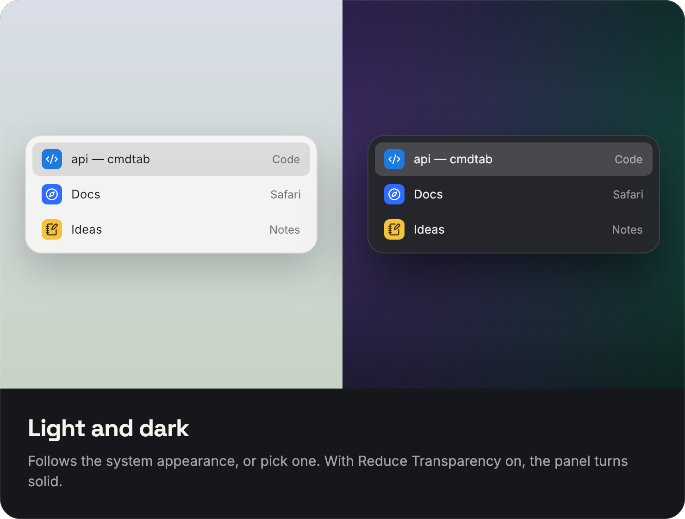</td>
  </tr>
  <tr>
    <td>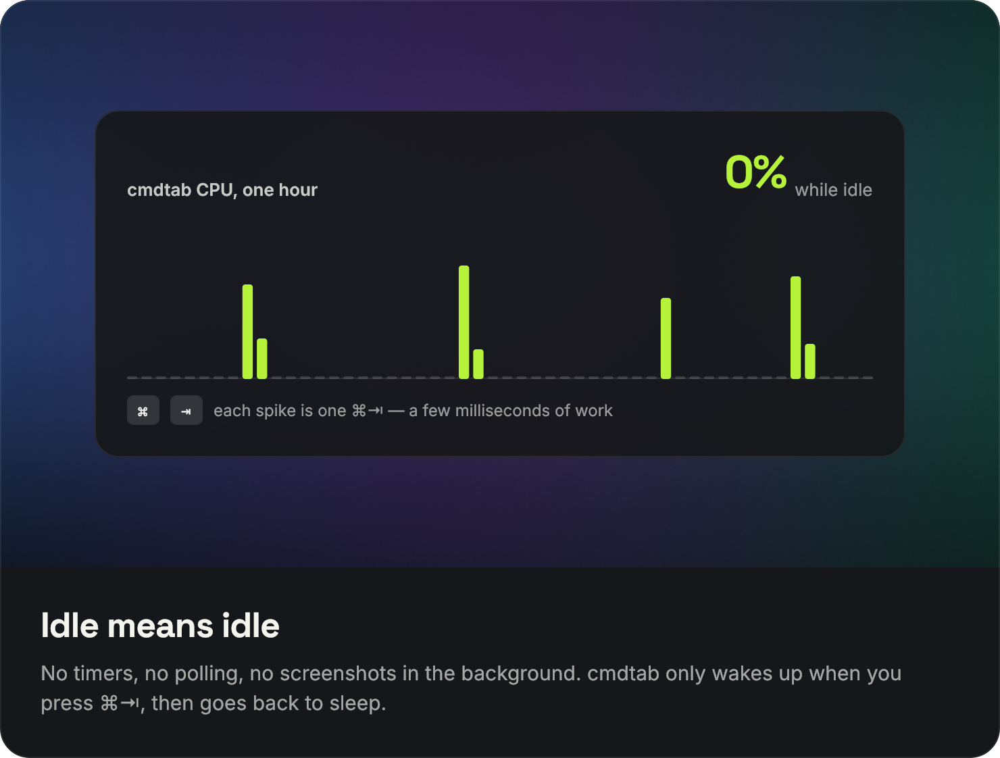</td>
    <td>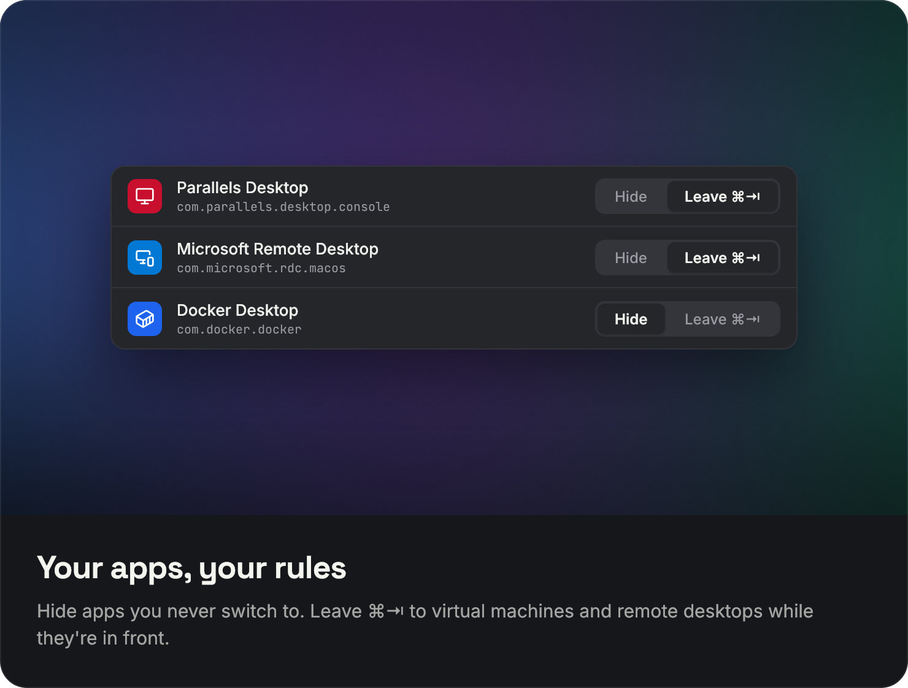</td>
  </tr>
</table>

## Three styles

<p align="center">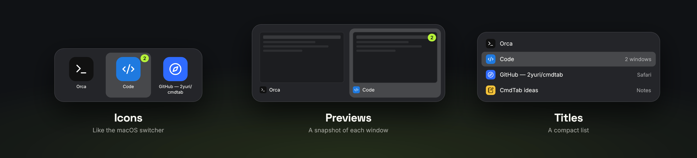</p>

Icons like the macOS switcher, a snapshot of each window, or a compact list of titles. Previews are
captured only while the switcher is open, kept in memory, and never saved or sent anywhere.

Search with **⌘F** while the switcher is open, or turn on **Open in search mode** so the search bar is
always there: hold ⌘ and tap ⇥ as usual, or let go of ⌘ and type.

## Tiling 

<table>
  <tr>
    <td width="50%">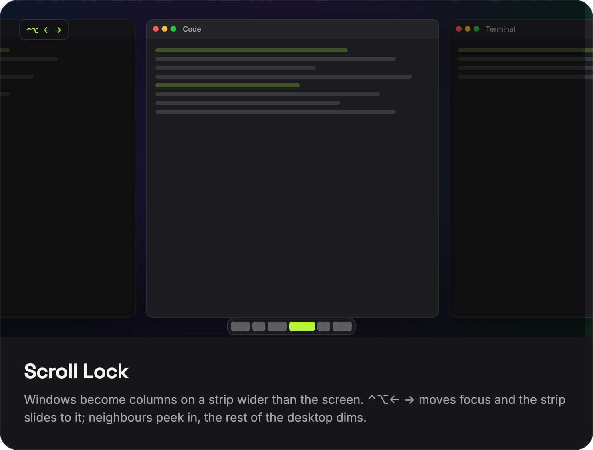</td>
    <td width="50%">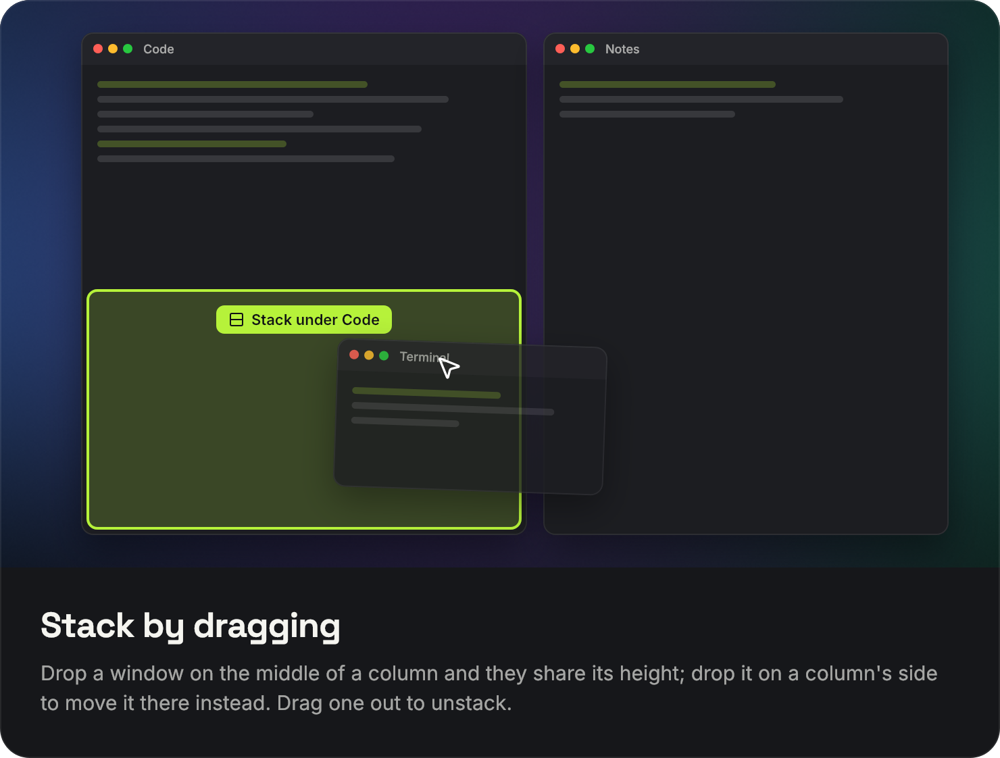</td>
  </tr>
  <tr>
    <td>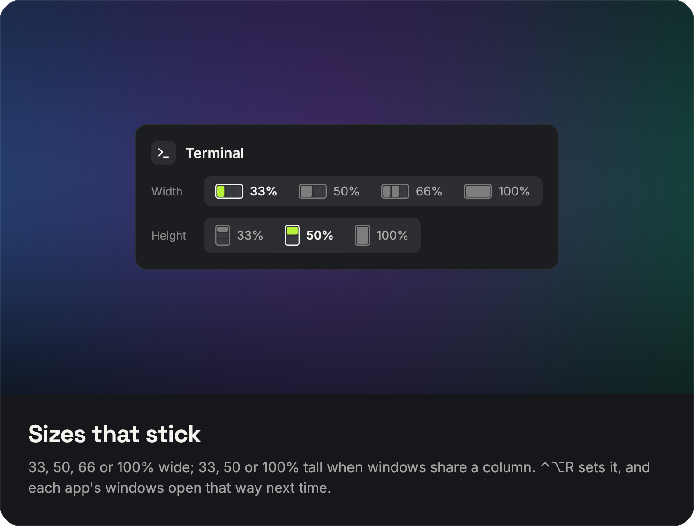</td>
    <td>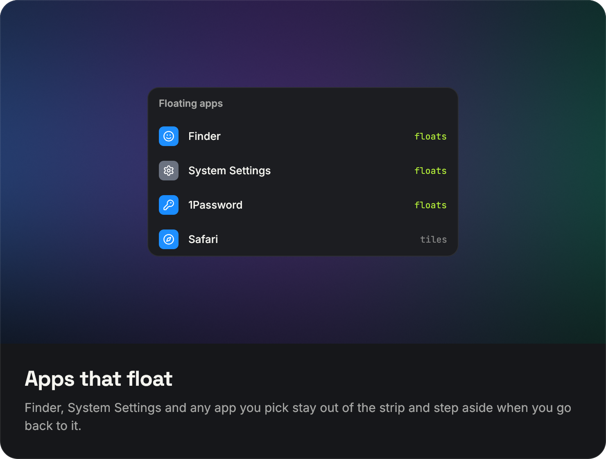</td>
  </tr>
</table>

Off by default; turn it on in **Settings → Tiling**.

- **Scroll Lock.** The windows on the current desktop become full-height columns on a strip wider than
  the screen. Focus moves with ⌃⌥← → (or the switcher, or a click) and the strip slides there, so the
  columns in between pass by like a scroll. Neighbouring columns peek in at the sides. Hold ⌃⌥ and
  scroll sideways to slide the strip by hand; it settles on the column you stop at. Optional: wrap
  around from the last column to the first, animation speed, or no animation.
- **Stacks.** Drag a window onto the top or bottom half of another column (the half lights up) and
  they share it, up to three per column. Drag it out, or press ⌃⌥S, to unstack.
- **Sizes that stick.** Columns are 33, 50, 66 or 100% wide; stacked windows 33, 50 or 100% tall.
  Cycle with ⌃⌥R and ⌃⌥⇧R or drag an edge; each app's next windows open the same way. Every remembered
  size is listed, searchable, in Tiling › Remembered Sizes.
- **Floating apps.** Finder, System Settings and the other apps that come with macOS, plus any app you
  add, stay out of the strip. Going back to the strip hides them (like ⌘H) until you ⌘⇥ to them.
- **Screen padding.** Keeps every window, tiled or not, a set distance from the screen edges, measured
  from the edges so the menu bar counts towards it.
- **Dim other windows.** A dark layer right below the focused window.

Turning Scroll Lock off puts every window back where it was.

## Keys

| Keys | Action |
|---|---|
| ⌘⇥ / ⌘⇧⇥ | Open the switcher, next / previous window |
| ← → ↑ ↓ | Move the selection (↑↓ move by row) |
| Release ⌘ or ↩ | Switch to the selected window |
| esc | Close without switching |
| ⌘F | Search |
| ⌘W / ⌘M / ⌘Q | Close the window / minimize it / quit its app, without switching |

A quick ⌘⇥ tap switches to the previous window without showing the panel.

With Scroll Lock on:

| Keys | Action |
|---|---|
| ⌃⌥← / ⌃⌥→ | Focus the column on the left / right |
| ⌃⌥ + scroll | Slide the strip |
| ⌃⌥⇧← / ⌃⌥⇧→ | Move the focused column |
| ⌃⌥R / ⌃⌥⇧R | Cycle the column's width / the window's height in a stack |
| ⌃⌥S | Stack the window under the column on its left, or take it out |
| ⌃⌥↑ / ⌃⌥↓ | Focus within a stack |

## Settings

<p align="center">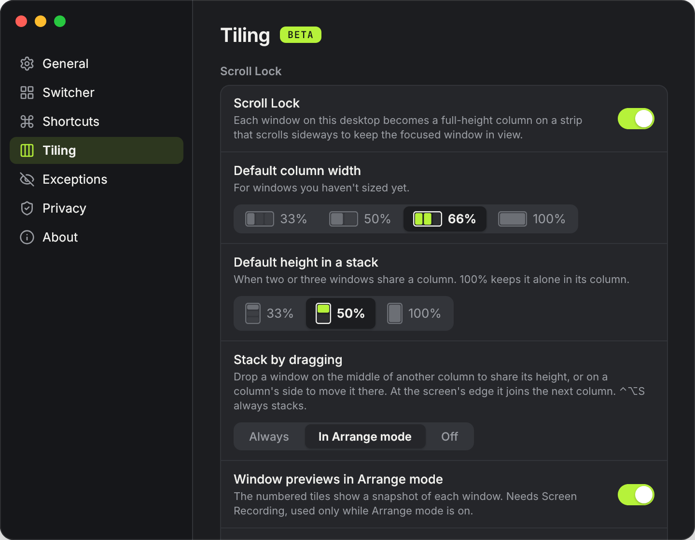</p>

Open them from the ⌘ icon in the menu bar, or by opening cmdtab again.

- **Switcher:** current desktop or all desktops, grouping by app, minimized and hidden windows,
  style, size, theme, preview of the selected window, quick switch, search mode.
- **Shortcuts:** what every key does, and a switch to hand ⌘⇥ back to macOS.
- **Tiling (beta):** Scroll Lock, column widths and stack heights, remembered sizes, floating
  apps, animation, screen padding, dimming.
- **Exceptions:** hide apps from the switcher, or leave ⌘⇥ to an app while it is in front
  (virtual machines, remote desktops).
- **Privacy:** what cmdtab can access, live.
- **About:** version, and automatic updates (on by default, one check a day).

cmdtab follows the system light/dark appearance and Reduce Transparency, and labels its tiles for
VoiceOver.

## Install

1. Download **CmdTab-vX.Y.Z.dmg** from the [latest release](https://github.com/2yuri/cmdtab/releases/latest).
2. Open it and drag **CmdTab** to **Applications**. The app and the disk image are signed with a
   Developer ID and notarized by Apple, so they open without warnings. A `.zip` of the app is there too.
3. On first launch, allow **Accessibility** (System Settings → Privacy & Security → Accessibility).
   cmdtab takes over ⌘⇥ as soon as that is granted.

Requires macOS 14 or later. Later versions install themselves: cmdtab checks once a day and asks
before it installs. Turn that off in Settings → About.

<details>
<summary>Build from source</summary>

```sh
brew install xcodegen
git clone https://github.com/2yuri/cmdtab.git && cd cmdtab
make install            # builds a Release app and copies it to /Applications
```

Signing uses the team in `project.yml`. To build with your own Apple ID, pass your team ID:
`make install DEVELOPMENT_TEAM=YOURTEAMID`.

</details>

## How it works

| | |
|---|---|
| Hot keys | ⌘⇥ is a Carbon global hot key, so the WindowServer wakes cmdtab only for that key. In-switcher keys are registered only while the panel is open, and keep working under Secure Input. |
| Window list | One WindowServer query for the on-screen order (most recently used first), filtered by Space, plus one Accessibility call per app for titles. Built on demand, never kept in sync. |
| Focusing | Brings the exact window forward, unminimizing or unhiding it when needed. |
| Previews | ScreenCaptureKit snapshots, only while the panel is open, selected window first. |
| Tiling | Event-driven: Accessibility notifications (window opened, closed, focused, moved) and ⌃⌥ hot keys. Windows are moved through Accessibility; slides are paced by the display, each app on its own queue. Columns out of view are parked just past the right edge of the screen. The scroll tap is switched on only while ⌃⌥ is held. |
| Updates | [Sparkle](https://sparkle-project.org) fetches `appcast.xml` from the latest GitHub release once a day. An update installs only if its EdDSA signature matches the key in the app and it carries the same Developer ID. No system profile or other data is sent. |

Telling which Space a window is on and focusing one specific window has no public API, so cmdtab uses a
few private SkyLight calls (`Sources/CmdTab/System/PrivateAPI.swift`). They are resolved at runtime: a
macOS update that removes one disables that feature instead of crashing the app.

> [!NOTE]
> Turning the native ⌘⇥ off is global WindowServer state that outlives the process. cmdtab turns it back
> on when it quits, is paused, or receives a termination signal. If it is force-killed (`kill -9`) or
> crashes, open cmdtab again and quit it from the menu, or log out.

### Troubleshooting

Diagnostics go to the unified log at debug level (free unless someone is reading them):

```sh
log stream --level debug --predicate 'subsystem == "dev.yuri.CmdTab"'
```

If Accessibility shows cmdtab as enabled but it still asks, remove it from the list with − and add it
again: the permission is tied to the app's signature.

## Contributing

Bug reports, ideas and pull requests are welcome. See [CONTRIBUTING.md](CONTRIBUTING.md). cmdtab aims to
stay small: features that need always-on background work are out of scope.

## License

[GPL-3.0](LICENSE) © 2026 Yuri Miguel
